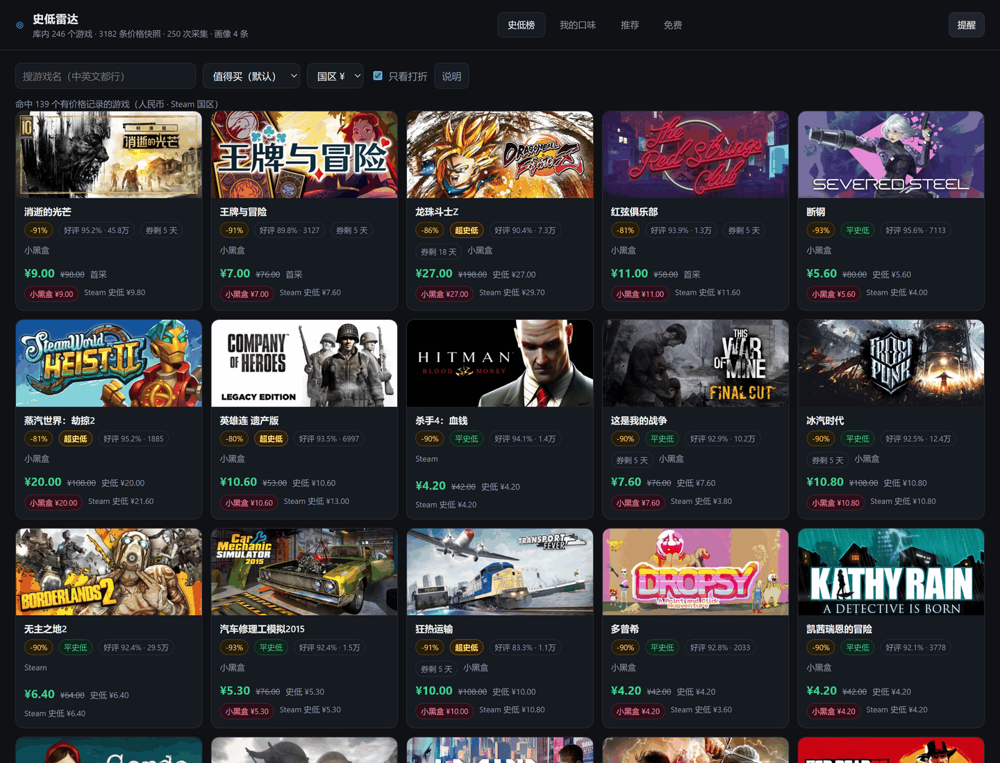
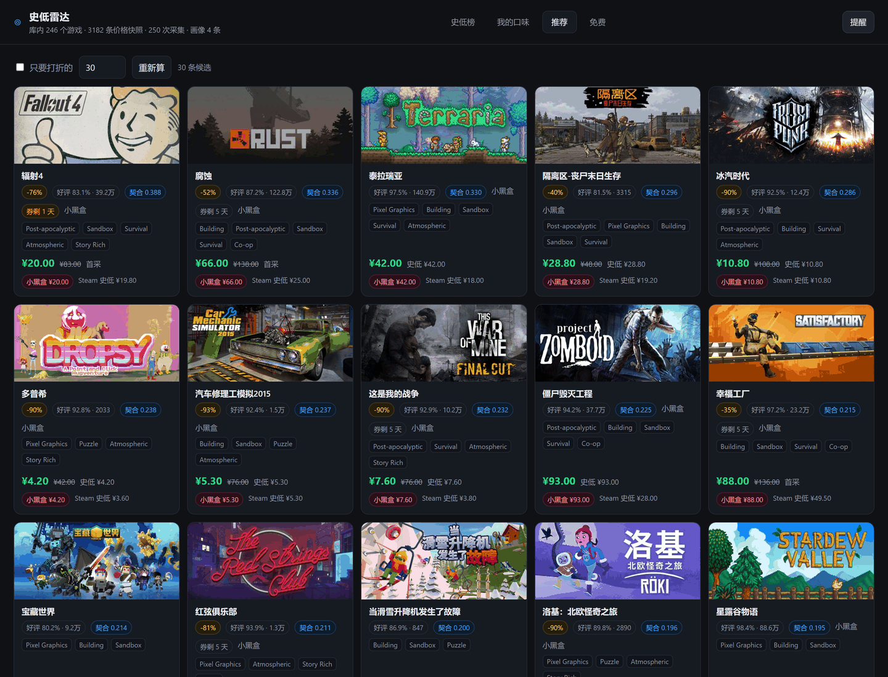

# hd-deal-radar

> **Is this game at its all-time low right now — should I buy it today?**
> 这个游戏现在是史低吗？我该现在买吗？

跨平台 PC 游戏史低聚合 + 按你自己的游玩画像推荐。**Python + 原生 HTML/JS，无构建、无前端依赖；后端只额外要一个 `requests`**，整个应用跑在你自己的电脑上。

多数比价站算的是「相对原价的折扣百分比」。hd-deal-radar 算的是另外两件事：

1. **小黑盒券后到手价** —— 国内实际能付的钱，而不是 Steam 标价；
2. **「破史低」标记** —— 只有现价**低于 Steam 官方历史最低价**时才高亮（界面上写作「超史低」），其余老实标「史低」/「平史低」/「首采」，不糊你。



<details open>
<summary><b>30 秒速览（想直接跑就照这三行）</b></summary>

```powershell
git clone https://github.com/HokleinDelrin/hd-deal-radar.git && cd hd-deal-radar
pip install -r requirements.txt        # 只有一个包：requests
python -m radar.cli init; python -m radar.cli fetch --pages 1; python -m radar.cli serve
```

然后开 http://127.0.0.1:8790 。

- **这是什么**：在你自己的电脑上盯住一批 PC 游戏，回答「今天这个价是不是史低、该不该现在买」，并按你玩过的游戏推荐正在打折的。
- **前置条件**：Python 3.10+ 和 `requests`。**不需要任何 API key**（ITAD / Steam key 是可选增强）。
- **唯一的可选登录**：小黑盒源（国内券后到手价）要你先登录自己的小黑盒账号；不登录就跳过这个源，其余照常。
- 程序本身有没有坏：`python -m radar.cli selftest`（28 项离线断言，不联网）。

</details>


## 它和 SteamDB / GG.deals / IsThereAnyDeal 差在哪

先说结论：**这三个站的历史数据都比本项目全，覆盖的商店也比本项目多。** 本项目的差异不在数据量，在问的问题。

| | SteamDB | GG.deals | IsThereAnyDeal | hd-deal-radar |
|---|---|---|---|---|
| 历史价格数据 | ✅ 最全（多年逐日） | ✅ 很全 | ✅ 很全（也是本项目的数据源） | ⚠️ 只有本地跑过的快照，第一天等于「首采」 |
| 覆盖商店 | ✅ Steam + 多平台 | ✅ 官方店 + Key 站 | ✅ 几十家店 | ⚠️ Steam / 小黑盒 / CheapShark / Epic / ITAD（可选） |
| 候选游戏池 | 全站 | 全站 | 全站 | ⚠️ 现在 246 个，不是全网 |
| 界面语言 | 英文 | 英文 | 英文 | 中文 |
| **小黑盒券后到手价** | ❌ | ❌ | ❌ | ✅ |
| **「破史低」判定（低于 Steam 官方史低）** | 不这么标 | 不这么标 | 不这么标 | ✅ 卡片高亮 |
| 券到期倒计时 | ❌ | ❌ | ❌ | ✅「券剩 N 天」，≤3 天转黄 |
| 按**自己的游玩画像**推荐正在打折的游戏 | ❌ | ❌ | ❌ | ✅ 玩过只狼/黑魂 → 推「正打折、且像它」的 |
| 数据存在谁那里 | 他们服务器 | 他们服务器 | 他们服务器 | 你自己电脑，一个 SQLite 文件 |

一句话：**要比价、要看十年价格曲线，去 SteamDB / ITAD；要判断「我这个人在国内、今天该不该按下付款」，用这个。**

## 快速开始

Python 3.10+。**唯一要装的东西是 `requests`，不需要任何 API key 就能跑起来**（ITAD / Steam key 都是可选增强）。

**1. 拿代码 + 装依赖**

```powershell
git clone https://github.com/HokleinDelrin/hd-deal-radar.git
cd hd-deal-radar
pip install -r requirements.txt
```

> 只装 `requests` 一个包。项目不用框架、不用前端构建、不用 node_modules。
> 不装它会在第一条命令就 `ImportError: No module named 'requests'`（`radar/http.py` 的网络层用它）。

**2. 建库 + 首次采集（约 2–4 分钟，实测 234 秒，逐条打进度）**

```powershell
python -m radar.cli init
python -m radar.cli fetch --pages 1
```

**3. 起界面**

```powershell
python -m radar.cli serve
```

浏览器打开 http://127.0.0.1:8790 —— 就是上面那张史低榜。

- 只想知道程序本身有没有坏：`python -m radar.cli selftest`（28 项离线断言，不联网）。
- 想看画像推荐长什么样：点「我的口味」加几个玩过的游戏，再切「推荐」。



## 几条不美化的实话

- **小黑盒源需要你先登录小黑盒账号**（`python -m radar.cli heybox-login`，或桌面版点「登录小黑盒」）。它的价格来自未公开接口，本项目不做匿名签名请求：不登录就跳过这个源，其余数据源照常工作。
- **ITAD / Steam key 都是可选的增强**。没有就自动跳过并在输出里说明，不会报错也不会卡住（无 key 冷启动实测：`{"games":60,"snapshots":304}`）。
- **候选池现在 246 个游戏，不是全网**。它的定位是「盯住一批你在乎的游戏谁在史低」，不是「搜什么都有」。
- **「史低」是本地快照算出来的**。Steam 官方不给历史价，所以第一天库里「当前价 == 最低价」，界面标「首采」而不是「史低」；跑满两轮采集后才有真实历史最低。想立刻拿到权威史低，填 ITAD key。
- **Windows 优先**：小黑盒登录走 Edge 的 CDP、通知走 Windows Toast，这两块在别的系统上不可用；采集、推荐、Web UI 本身是跨平台的。

## 目录

| 路径 | 什么 |
|---|---|
| `radar/` | 采集器 / 画像 / 推荐 / API / CLI，纯标准库 |
| `web/` | 静态前端，无构建 |
| `docs/数据源.md` | 8 个数据源的端点、限速、踩坑实测 |
| `docs/推荐算法.md` | 画像向量与排序公式 |
| `app.py` | PyInstaller 桌面版入口 |
| `assets/` | 截图 |

MIT License，见 `LICENSE`。

---

## 详细文档 · game-deal-radar（史低雷达）

> 交接文档：`HANDOVER.md`（新会话先读它再开工）

**状态（2026-11-12）：** 可运行。采集 / 史低快照 / 画像 / 推荐 / 本地 Web UI 全链路打通，已用真实数据跑过。
**最近更新：** 2026-11-14（发布前自检：依赖声明纠错、README 私有路径清理，见 `docs/发布自检报告.md`；功能最后一次变更是 2026-11-12）

## 这个任务是干什么的

把两件事装进同一个应用：

1. **史低聚合** —— 从多个平台搜罗 PC 游戏当前价与历史最低价，**带小黑盒到手价**：
   Steam 国区现价、Steam 官方史低、小黑盒券后价、第三方店（GMG/Fanatical…）、Epic 免费。
2. **画像推荐** —— 用「我玩过、喜欢玩的游戏」当输入，支持两种粒度：
   - 只给名字（`只狼`、`Hades`）；
   - 给名字 + 说清楚喜欢哪些地方（`只狼 喜欢招架手感，不要迷路`）。
   两者都落成同一 tag 空间里的向量，再据此推荐新游戏，**并且优先推正在打折 / 接近史低的候选** —— 推荐和史低是同一个列表，不是两个功能。

## 实测样板

《最终幻想7 重制版》：Steam 198 / Steam 官方史低 49.5 / **小黑盒券后 33**（-82%）。
现价低于 Steam 官方史低时，卡片打「破史低」标 —— 这才是真正该出手的时候。

## 当前状态 / 待办

- [x] 建目录 + git init + 骨架四件套
- [x] 数据源实测（Steam / SteamSpy / CheapShark / Epic / ITAD / SteamDB / GG.deals / 国内站），结论见 `docs/数据源.md`
- [x] SQLite schema + 价格快照落库 + 史低计算（自建，不依赖外部口径）
- [x] 采集器：`radar/sources/{steam,steamspy,cheapshark,epic,itad,steamlib,heybox}.py`，全部带 cache 落盘
- [x] 画像：tag 别名表（~180 条口语）、否定识别、TF-IDF 向量
- [x] 推荐：余弦相似 + 已拥有排除 + 折扣加权 + 命中理由
- [x] 本地 Web UI：史低榜 / 我的口味 / 推荐 / 免费 四个页签 + 详情抽屉（价格曲线、各店比价、相似游戏）
- [x] 离线自检 `selftest`（28 项断言，不联网：tag/画像/去重 + Steam 引用解析 + ITAD 响应解析）
- [x] 小黑盒源（自实现 hkey 签名）：到手价 + Steam 官方史低 + 券截止时间
- [x] 「破史低」标记：现价低于 Steam 官方史低时高亮
- [x] 默认排序「值得买」= 贝叶斯好评率 45% + 有效折扣 30% + 史低信号 25%
- [x] 券快过期提醒：卡片显示「券剩 N 天」，≤3 天转黄
- [x] 价格快照去重：同价不写新行，每天跑也不涨数据
- [x] **史低等级筛选**：超史低 / ★星史低 / 平史低 / 接近史低 / 首采 一排多选按钮，各带条数（`?states=super,new` 可深链），
      与搜索/排序/币种/「只看打折」叠加；另有「只看破纪录」「只看真史低」两个一键预设
- [x] 定时采集分层：周一全量 / 其余日子轻量（`python -m radar.cli daemon --at 09:30` 或 `install-task.ps1`）
- [x] `keys` 命令：写入并**在线校验** ITAD key / Steam key / steamID（含 profile 是否公开）
- [x] ITAD 批量接入：`POST /games/prices/v3` + `POST /games/historylow/v1`，appid→uuid 映射落 meta 复用
- [x] Steam 库导入：`sync-owned`（`--dry-run` 先看清单、`--id` 临时指定、`--wishlist` 导愿望单进关注列表）
- [x] **推送提醒**：跌到史低时弹 Windows 通知（可选 Telegram），同价不重复响
- [x] 推荐 MMR 去重（`--diversity`）、索引缓存、appdetails 并发、`prices` 复合索引
- [x] 修掉「每天的 fetch 把 SteamSpy 补好的 tag 抹成 NULL」的 bug（详见 QA 2026-11-12）
- [ ] **等你填 key**：ITAD → `keys --itad <KEY>`；Steam → `keys --steam-key <KEY> --steam-id <链接>`
- [ ] 候选池扩到 800+（现在 246）

## 排序怎么选

| 排序 | 出来的东西 | 什么时候用 |
|---|---|---|
| **值得买（默认）** | Dying Light（9 元 / -91% / 好评 95.2% / 45.8 万条 / 破史低）这类 | 打开就问「今天买什么」 |
| 先看史低 | 折扣最狠的，但可能好评只有 57% | 只想捡便宜、自己会判断 |
| 按好评率 | 传送门 98.5%、星露谷 98.4%，但**全是不打折的原价** | 想找「值得玩」而不是「值得买」 |
| 按折扣 / 按价格 / 按小黑盒价 / 按 MC 分 | 单维度硬排 | 有明确目的时 |

纯按好评率会推荐一堆原价经典，纯按折扣会推荐一堆没人要的 -95% —— 所以默认用混合分。

## 文件清单

| 文件 | 作用 |
|---|---|
| `AGENTS.md` | 文档路由表 —— 什么场景读哪份 |
| `README.md` | 本文件，当前状态与待办 |
| `LOG.md` | 时间线，只增不改 |
| `QA.md` | 决策库，只增不改 |
| `docs/数据源.md` | 每个源实测结论：端点、key、限速、能不能给史低、踩过的坑 |
| `docs/推荐算法.md` | 画像与推荐的公式、参数、已知局限 |
| `radar/config.py` | 配置（key 从 `config.local.json` 或环境变量读） |
| `radar/http.py` | 带缓存/限速/失败回退旧缓存的请求层 |
| `radar/db.py` | SQLite：games / prices / watch / profile_entries |
| `radar/tags.py` | 口语 → Steam tag 别名表、否定判定、未识别词回收 |
| `radar/recommend.py` | TF-IDF 索引、画像向量、余弦推荐、相似游戏 |
| `radar/sources/` | 每个数据源一个文件 |
| `radar/server.py` | 标准库 `http.server` 的 JSON API + 静态页 |
| `radar/tray.py` | Windows 通知区托盘图标（ctypes 调 Shell_NotifyIconW，零依赖） |
| `radar/updater.py` | 采集调度：启动自动跑一轮 + 间隔限制 + 状态给前端轮询 |
| `radar/cli.py` | 命令行入口（init / fetch / harvest / enrich / add / profile / rec / low / serve / selftest） |
| `web/` | 静态前端，原生 HTML/JS，无构建 |
| `data/` | SQLite 库（不入 git） |
| `cache/` | 各源原始响应缓存，可复查（不入 git） |

## 桌面版（不想碰命令行就用这个）

`dist/史低雷达.exe`（约 15 MB，单文件）—— 双击就起服务、自动打开界面，**没有窗口**，只在通知区留一个 ◎ 图标：

> ⚠️ **EXE 不在仓库里**（`dist/` 和 `*.spec` 已进 `.gitignore`，仓库里只有打包入口 `app.py`）。
> clone 下来想用桌面版，得自己打包一次，命令见本节末尾。不想打包就 `python -m radar.cli serve`，功能完全一样。

| 托盘（右键） | 作用 |
|---|---|
| 打开界面 | 再开一个浏览器标签（**双击图标**也是这个） |
| 立即更新数据 | 手动补一轮采集；平时不用点，见下 |
| 小黑盒：登录… / 读取登录态 | 登录一次，之后采集自动带登录态 |
| 退出 | 删图标 + 停服务 + 进程结束 |

- **启动就自动采集一轮**（后台线程，不挡网页打开），不用手动点。
  距上次采集不足 **30 分钟**就跳过 —— 自动更新永远不比手动更频繁（依据见 `docs/数据源.md`「自动更新」）。
  参数与旧版「更新数据」按钮一致：`fetch --specials 20 --pages 0 --heybox 20`。
- 网页顶部常驻一行状态：`上次更新 于 2026-11-15 15:55`，采集中变成 `上次更新 于 … · 正在更新中…`。
  旁边「立即更新」是手动补刀，「退出服务」是「托盘被系统折叠/找不到」时的退出兜底。
- 数据在 `%LOCALAPPDATA%\GameDealRadar\data\radar.db`，不放在 EXE 旁边 —— 换 EXE 不丢库存。
  首次运行若 EXE 同级或上一级有 `data/radar.db`，会自动迁移一份过去。
- 托盘是自己画的：`ctypes` 直调 `Shell_NotifyIconW`（`radar/tray.py`），**没装 pystray，也没装 Pillow**。

重新打包：

```powershell
pip install pyinstaller
pyinstaller --noconfirm --onefile --noconsole --name "史低雷达" --add-data "web;web" --add-data "fixtures;fixtures" app.py
```

## 小黑盒：先登录，再用（默认强制）

小黑盒的价格来自**未公开接口 + web 签名**，这套做法本身就带「绕过对方技术措施」的意味。
所以现在的规则是：**没登录就不取小黑盒数据**（`config.heybox_require_login` 默认 `true`），
其余源（Steam / ITAD / CheapShark / Epic）不受影响，照常工作。

登录用的是「你自己的浏览器会话」这条路：

```powershell
python -m radar.cli heybox-login            # 弹一个独立 profile 的 Edge，你登录，按回车存 cookie
python -m radar.cli heybox-login --status   # 看存了什么、像不像真的登录了
python -m radar.cli heybox-login --clear    # 清除
python -m radar.cli heybox-login --paste "<F12 复制来的 Cookie 头>"   # 不想开浏览器时的兜底
```

- 用 `--user-data-dir=data/edge-profile` 的独立配置，不碰你日常浏览器；profile 保留，下次不用重登。
- 抓 cookie 靠 Edge 的 CDP（`--remote-debugging-port`），**零额外依赖**（不装 selenium / playwright）。
- 登录**不等于**免签名：签名是反爬门禁、不是鉴权，请求里照样要带。登录改变的是「以谁的身份取」。
- 未登录时首页也会种 `lang` / `smidV2` / `x_xhh_tokenid`，所以「看起来登录了」会单独提示，不做静默通过。

## 怎么跑

```powershell
cd hd-deal-radar

python -m radar.cli init                                    # 初始化库
python -m radar.cli selftest                                # 离线自检，不联网

# 采集（第一次建议这样跑一遍）
python -m radar.cli harvest --source top100in2weeks          # 铺候选池（100 个热门）
python -m radar.cli fetch --specials 30 --pages 2 --epic     # 抓国区现价 + 跨店比价 + 免费
python -m radar.cli enrich --budget 100                      # 给缺 tag 的补 SteamSpy tag（1.4s/个）
python -m radar.cli heybox --all                             # 补小黑盒到手价 + Steam 官方史低

# 画像 → 推荐
python -m radar.cli add "只狼" --why "喜欢招架手感和成就感，不要迷路" --weight 1.5
python -m radar.cli profile                                  # 看画像被解释成哪些 tag
python -m radar.cli rec --top 20 --discount-only             # 只要正在打折的推荐
python -m radar.cli low 1462040                              # 单个游戏各渠道价格对照

# 界面
start.cmd          # 或者 python -m radar.cli serve  → http://127.0.0.1:8790

# 每日自动采集（分层：周一全量，其余日子轻量）
python -m radar.cli daemon --at 09:30          # 常驻：到点自动选当天该跑哪一档（Ctrl+C 退出，日志 data/scheduler.log）
python -m radar.cli daemon --once              # 调试：立刻跑一轮
.\install-task.ps1 -DryRun                     # 或交给 Windows 计划任务：先 -DryRun 看命令，去掉即注册；-Unregister 卸载

# 提醒（默认不打断你：攒着，到点由你自己配的汇总器一次提醒）
python -m radar.cli notify                     # 只记进提醒中心 + 入队，不弹
python -m radar.cli notify --now               # 真的要立刻弹一条
python -m radar.cli notify --dry-run           # 只看会提醒什么
python -m radar.cli notify --test              # 逐条通道自测：弹窗 + 声音 + 系统到底收没收到

# 推荐去重与限速
python -m radar.cli rec --top 20 --diversity 0.3   # 把「同一批 tag 扎堆」的结果压掉
python -m radar.cli fetch --specials 40 --concurrency 4   # appdetails 4 线程（实测 3.4× 加速，无 429）
```

> 提醒队列的「定点汇总」那一步，写向 `~/.dsh/tools/notify-hub.py`（我自己的多应用汇总脚本，**不在本仓库里**）。
> 你机器上没有这个文件时，`notify` 照样把提醒写进网页「提醒」面板，只是入队那一步跳过并打一行提示 ——
> 不报错、不丢提醒。想要定时汇总，把 `notify --now` 挂进你自己的计划任务即可。

**关于「史低」的正确预期**：Steam 官方不给历史价，所以第一天的库里「当前价 == 最低价」，
界面上这时标 `首采` 而不是「史低」。跑满两轮采集之后才开始有真实的历史最低；
想立刻拿到完整史低，去 https://isthereanydeal.com/apps/my/ 免费拿个 key（1000 请求/5 分钟）。

## 可选配置：两个 key 怎么接（一条命令搞定）

```powershell
python -m radar.cli keys --itad <ITAD_KEY>                    # https://isthereanydeal.com/apps/my/
python -m radar.cli keys --steam-key <STEAM_KEY> --steam-id "<主页链接或17位ID>"
python -m radar.cli keys --check                              # 只校验，不写

# 接上之后
python -m radar.cli itad --limit 246        # ITAD 多店现价 + 官方史低（映射已提前建好）
python -m radar.cli sync-owned --dry-run    # 先看会把哪些游戏、按什么权重导进画像
python -m radar.cli sync-owned --limit 40   # 真导入（已存在的 liked 自动跳过）
python -m radar.cli sync-owned --wishlist   # 愿望单 → 关注列表（这条不需要 Steam key）
```

`keys` 写完会立刻联网校验三项，并直说失败原因：ITAD 403 是 key 无效；Steam ID 能解析但
`privacyState` 不是 `public` 时会直接告诉你「去把游戏详情设为公开」——不用等跑完采集才发现读空。
`steam_id` 允许填 17 位 ID、`steamcommunity.com/profiles/<id>`、`steamcommunity.com/id/<vanity>`
或裸自定义名，这几种形态都靠公开 profile XML 解析，不需要 Steam key。

## 可选配置（`config.local.json` 原文）

复制 `config.local.example.json` → `config.local.json`：

- `itad_api_key`：填了就启用 ITAD 作为史低权威源（覆盖几十家店）。
- `steam_api_key` + `steam_id`：填了就能 `python -m radar.cli sync-owned` 把 Steam 库里玩过的游戏
  按玩时长权重一次性导入画像（要求 Steam 隐私设置里「游戏详情」公开）。
